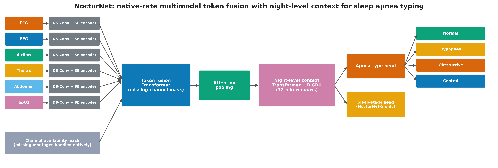
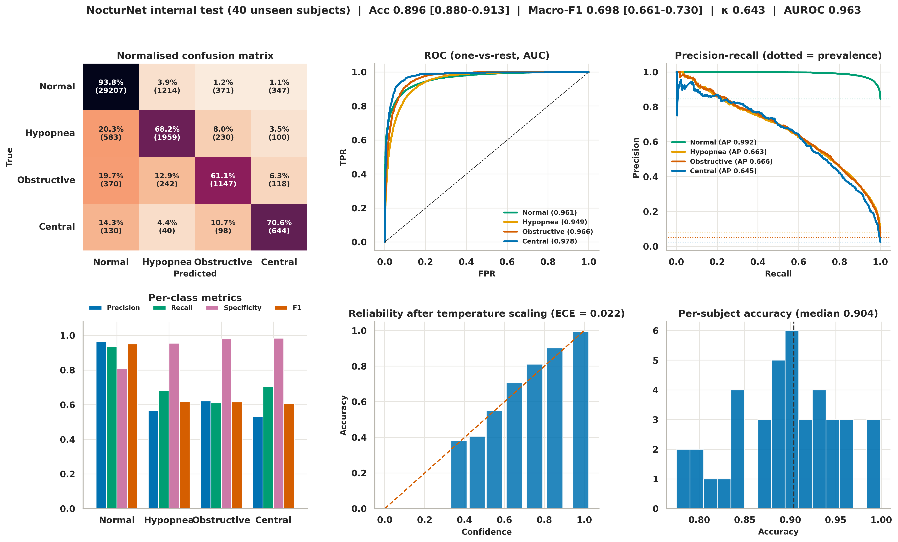
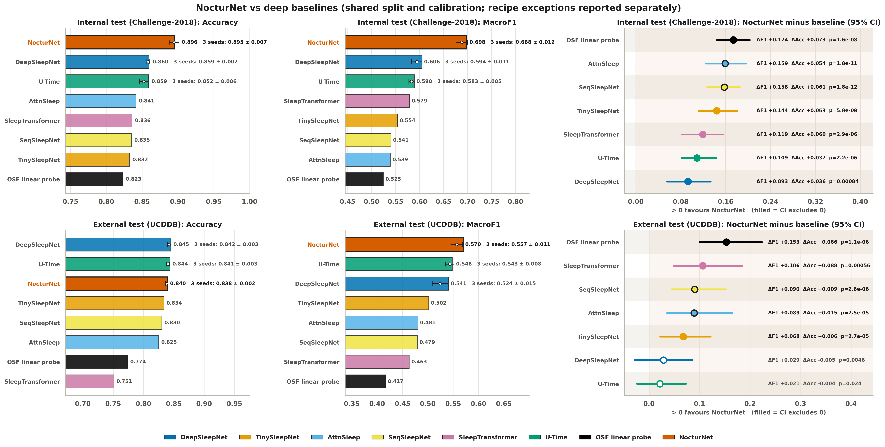
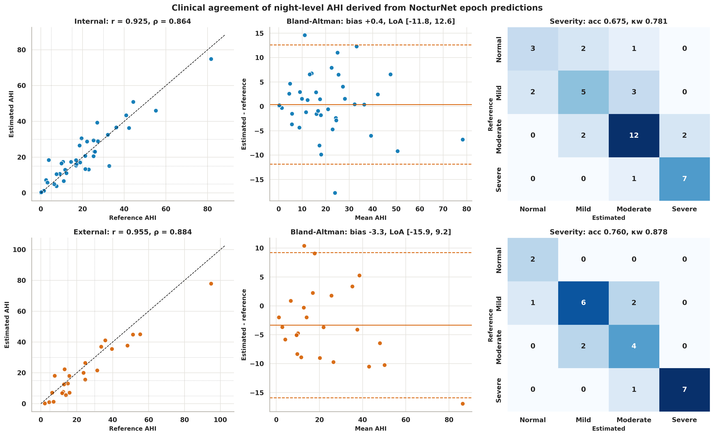
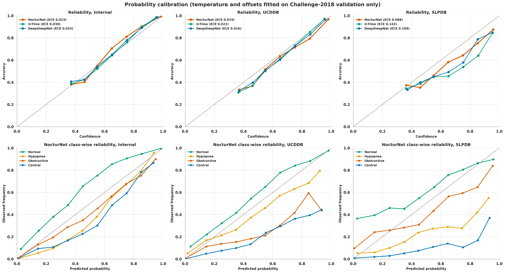

# NocturNet

**Native-rate multimodal token fusion with night-level context for sleep-apnea event classification**

A notebook-based research implementation for four-class respiratory-event classification from polysomnographic (PSG) recordings. The supplied research package contains the original model and evaluation workflow, experiment configurations, foundation-model context, and 37 scientific figures.

> **Archival release.** This GitHub presentation preserves the supplied research implementation and results. The original notebook, configurations, figures, and binary artifacts are not refactored, edited, or rerun as part of this repository preparation. Numerical results below are transcribed from the notebook's saved outputs, not newly computed for this release.

## Research overview

NocturNet integrates six physiological channels recorded at native processing rates: **ECG**, **EEG**, **airflow**, **thoracic effort**, **abdominal effort**, and **SpO₂**. The notebook implements per-modality convolutional encoding, cross-modality Transformer-based token fusion, attention pooling, and a temporal context model combining a Transformer and bidirectional GRU. The respiratory-event output covers **Normal, Hypopnea, Obstructive, and Central** classes. A supplementary model variant (*NocturNet-S*) adds a sleep-stage prediction head.



*Figure: supplied NocturNet architecture. Source: `Code/figures/04_architecture.png`.*

### Implementation at a glance

| Aspect | Recorded configuration |
|---|---|
| Signals | ECG, EEG, airflow, thorax, abdomen, SpO₂ |
| Processing rates | 64 Hz (ECG/EEG); 16 Hz (remaining modalities) |
| Analysis epoch | 30 seconds |
| Temporal sequence | 64 epochs, stride 32 |
| Primary prediction | Four-class respiratory event classification |
| Optional prediction | Sleep stages via NocturNet-S |
| Framework | Python, PyTorch; Google Colab-oriented notebook |
| Experiment seeds | 42, 43, 44 (as recorded in configurations) |

The package also includes an **OSF-Base foundation-model study/probe** and associated assets. This is distinct from the principal NocturNet architecture; the backbone asset should not be interpreted as proof that the primary NocturNet model uses pretrained OSF features.

## Research material and results

### Datasets

The notebook includes experiments using the following PSG cohorts:

| Cohort | Use in the supplied workflow | Source |
|---|---|---|
| PhysioNet / CinC Challenge 2018 | Internal train/validation/test evaluation | [PhysioNet](https://physionet.org/content/challenge-2018/1.0.0/) |
| UCD Sleep Apnea Database (UCDDB) | External evaluation | [PhysioNet](https://physionet.org/content/ucddb/1.0.0/) |
| MIT-BIH Polysomnographic Database (SLPDB) | Additional external evaluation | [PhysioNet](https://physionet.org/content/slpdb/1.0.0/) |

The original notebook reports 200 Challenge-2018 subjects, 25 UCDDB subjects, and 18 SLPDB records from 16 subjects for the respective analyses. The datasets themselves are not bundled with the research archive; consult each source's access and citation requirements.

### Representative archived results

The following values are taken from the saved `NocturNet` result rows in the original notebook. **They have not been re-executed during GitHub packaging.**

| Evaluation cohort | Accuracy | Macro-F1 | Cohen's κ |
|---|---:|---:|---:|
| Challenge-2018 internal test | 0.8956 | 0.6984 | 0.6434 |
| UCDDB external | 0.8396 | 0.5697 | 0.5121 |
| SLPDB external | 0.6806 | 0.4717 | 0.3819 |

See the complete stored tables and analysis cells in [`NocturNet_FINAL.ipynb`](Code/NocturNet_FINAL.ipynb). Comparisons with other models, robustness analyses, multi-seed evaluations, calibration, event-level analysis, and AHI-related figures are also retained in the original package.

| Internal/external evaluation | Baseline comparison |
|---|---|
|  |  |

| Agreement analysis | Calibration |
|---|---|
|  |  |

The [figure atlas](docs/FIGURE_ATLAS.md) indexes **all 37 supplied figures** without replacing or altering them.

## Repository contents

```text
.
├── Code/                          # Original supplied research files (unchanged)
│   ├── NocturNet_FINAL.ipynb      # Complete research notebook, including saved outputs
│   ├── README.txt                 # Original supplementary-file description
│   ├── config.json
│   ├── data_config.json
│   ├── training_config.json
│   ├── foundation_model_config.json
│   ├── S1_configuration.json
│   ├── event_and_AHI_methods.json
│   ├── manifest.json
│   ├── provenance.json
│   ├── figures/                   # 37 original PNG figures
│   └── fm/
│       ├── osf_backbone.pth       # Original file; Git LFS
│       ├── osf_tokens.npy         # Original file; Git LFS
│       └── osf_tokens_records.json
├── docs/
│   ├── FIGURE_ATLAS.md
│   ├── NOTEBOOK_GUIDE.md
│   └── ARTIFACTS_AND_ACCESS.md
├── README.md                      # GitHub presentation only
├── CITATION.md                    # Bibliographic metadata to complete
├── LICENSE_STATUS.md             # Rights information not inferred
├── PUBLISHING.md                  # Original-preserving publication procedure
├── .gitattributes                 # Large-file tracking
└── .gitignore                     # Avoid new, unrelated local files
```

The `Code/` tree is preserved from `Code (1).zip`. The top-level Markdown and Git configuration files are **new documentation/publishing metadata only**. Neither model code nor figures are modified. The original archive also contains small Hugging Face cache metadata under `Code/fm/.cache/`; these remain part of the original source tree when publishing from the complete ZIP.

## Opening the notebook

The computational workflow is presented in the original notebook:

**[`Code/NocturNet_FINAL.ipynb`](Code/NocturNet_FINAL.ipynb)**

It was prepared in a Google Colab environment, mounts Google Drive when used there, and refers to historical runtime locations such as `MyDrive/QMLNet_v3` and `MyDrive/NocturNet`. See [Notebook guide](docs/NOTEBOOK_GUIDE.md) for the notebook's stage map and [Artifacts and access](docs/ARTIFACTS_AND_ACCESS.md) for the supplied-versus-runtime-file distinction.

This release intentionally supplies **no modified entrypoint, replacement environment, recreated dataset split, or regenerated result**. To execute the notebook, use the corresponding original data/cache and dependencies referenced by that notebook. The archived notebook itself retains its supplied saved results.

## Interpretation and scope

- This is a computational research artifact; **not a clinical diagnostic application**.
- Values and plots reflect the original notebook's stored records, without new verification or reinterpretation for this release.
- Physiological datasets and runtime-generated arrays/checkpoints beyond the distributed source package are not silently represented as included.
- The OSF foundation-model materials are separately identified from the primary NocturNet implementation.

## Citation, rights and acknowledgements

Project author names, final manuscript title, DOI, and the project's software license were not provided in the available research files. No bibliographic or licensing claims have been invented. See [Citation](CITATION.md) and [License status](LICENSE_STATUS.md) for the fields to complete prior to public release.

The research uses datasets distributed by [PhysioNet](https://physionet.org/) and references the [OSF-Open-Sleep-FM](https://github.com/yang-ai-lab/OSF-Open-Sleep-FM) project. Cite the original datasets and third-party foundation-model work under their respective terms.

---

*Prepared as a faithful GitHub presentation of the supplied NocturNet research archive. The scientific implementation and historical outputs have not been changed.*
