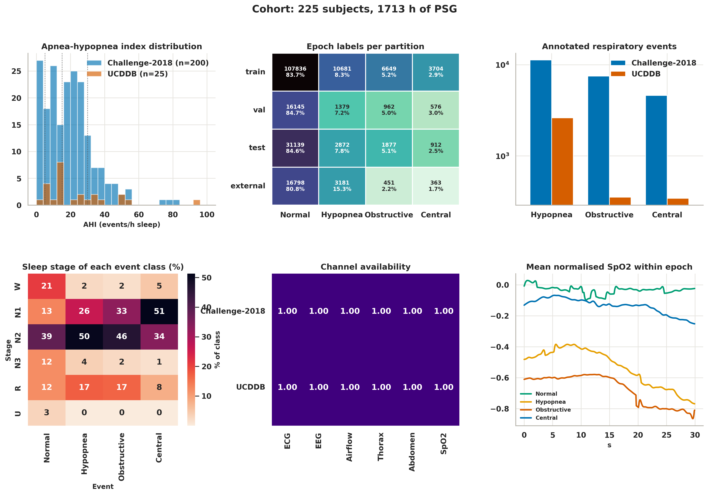

# Study datasets

The notebook includes experiments involving **PhysioNet/CinC Challenge 2018**, the **UCD Sleep Apnea Database (UCDDB)**, and the **MIT-BIH Polysomnographic Database (SLPDB)**.

## Cohorts

| Dataset | Study use | Number of records or subjects |
|---|---|---|
| Challenge 2018 | Training, validation and held-out test | 200 subjects |
| UCDDB | External evaluation | 25 subjects |
| SLPDB | Additional external evaluation | 18 records from 16 subjects |

The Challenge-2018 and UCDDB counts are recorded in Stages 2–3 (notebook cells 3–4). SLPDB counts are recorded in Stage 18 (cell 24).

## Challenge-2018 partition

| Partition | Subjects | Labelled epochs |
|---|---:|---:|
| Training | 140 | 128,870 |
| Validation | 20 | 19,062 |
| Test | 40 | 36,800 |

The study configuration specifies a 70%/10%/20% split and `n_challenge=200`. Partition counts are retained in the Stage 3 notebook output.

## External evaluation cohorts

| Cohort | Subjects | Labelled epochs |
|---|---:|---:|
| UCDDB | 25 | 20,793 |
| SLPDB | 16 | 10,185 |

The original notebook contains the dataset download, preprocessing and event-annotation handling functions. Its source defines PhysioNet file access using the `https://physionet.org/files/{db}/1.0.0/{p}` and `https://physionet-open.s3.amazonaws.com/{db}/1.0.0/{p}` URL patterns (Stage 2) and the SLPDB-specific file handling (Stage 18).

The processed arrays and runtime file paths used for evaluation are defined in the original notebook; see [Environment and data paths](SETUP_AND_REQUIREMENTS.md).
