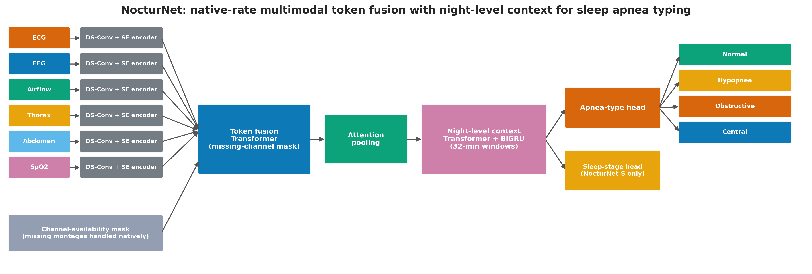

# Methodology

The computational definitions are provided in `Code/NocturNet_FINAL.ipynb`. Configuration values below are those recorded in `Code/config.json`, `Code/training_config.json`, and the corresponding notebook cells.

## Task and annotation processing

The model classifies respiratory events in 30-second PSG epochs as **Normal**, **Hypopnea**, **Obstructive**, or **Central**. Notebook Stage 1 (code cell 2) defines event-name mappings, signal selection, resampling, cleaning, annotation parsing and epoch construction. The configuration specifies `epoch_sec=30` and `min_overlap=5`.

## Signal representation

| Channel | Processing rate | Signal group |
|---|---:|---|
| ECG | 64 Hz | Fast-rate |
| EEG | 64 Hz | Fast-rate |
| Airflow | 16 Hz | Slow-rate |
| Thorax | 16 Hz | Slow-rate |
| Abdomen | 16 Hz | Slow-rate |
| SpO₂ | 16 Hz | Slow-rate |

The processing rates are specified by `fs_fast` and `fs_slow` in the supplied configuration. Temporal windows span 64 epochs, with a stride of 32 epochs. Each sequence therefore covers 32 minutes of epoch-level context.

## NocturNet architecture

Notebook Stage 7 (code cell 8) defines the `NocturNet` class, modality-specific feature encoders and model comparators. The primary model uses convolutional signal encoders, attention-based fusion, temporal Transformer processing and a bidirectional GRU. The notebook defines NocturNet-S as an auxiliary sleep-stage prediction variant.

The study separately explores frozen OSF-Base representations and an `OSFLinearProbe` comparator. The primary NocturNet and NocturNet-S constructors in the study's model registry use `use_fm=False`.

## Training parameters

| Parameter | Configured value |
|---|---:|
| Model dimension (`d_model`) | 128 |
| Sequence length (`seq_len`) | 64 |
| Sequence stride (`seq_stride`) | 32 |
| Training steps per epoch | 400 |
| Maximum epochs | 25 |
| Patience | 6 |
| Learning rate | 0.001 |
| Weight decay | 0.0001 |
| Focal-loss γ | 2.0 |
| Auxiliary-loss weight | 0.3 |
| Exponential-moving-average factor | 0.995 |
| Modality dropout | 0.15 |
| Recorded random seeds | 42, 43, 44 |

Stage 8 (code cell 9) contains the batching, training, augmentation, prediction and calibration routines. Stages 9–10 (cells 10–11) contain the NocturNet experiment and comparator executions.

## Evaluation design

The notebook includes the following analyses:

- **Held-out evaluation:** Challenge 2018 (Stage 11).
- **External evaluation:** UCDDB (Stage 11) and SLPDB (Stage 18).
- **Comparative analyses:** baseline models, NocturNet-S, ablations and repeated seeds (Stages 12–12b).
- **Montage analysis:** different channel configurations (Stage 12c and later external analyses).
- **AHI analyses:** overnight comparisons and event-related calculations (Stages 13 and 16).
- **Model interpretation:** token attention, embedding analysis and saliency (Stage 14 and related figure stages).

The AHI-related implementation includes calculations using respiratory-positive epochs, a calibration factor and sleep-time normalisation. The exact functions are retained in `Code/event_and_AHI_methods.json` and notebook Stages 13 and 16.

For numerical findings, refer to [Results](RESULTS.md); for the full notebook stage sequence, see [Notebook guide](NOTEBOOK_GUIDE.md).
