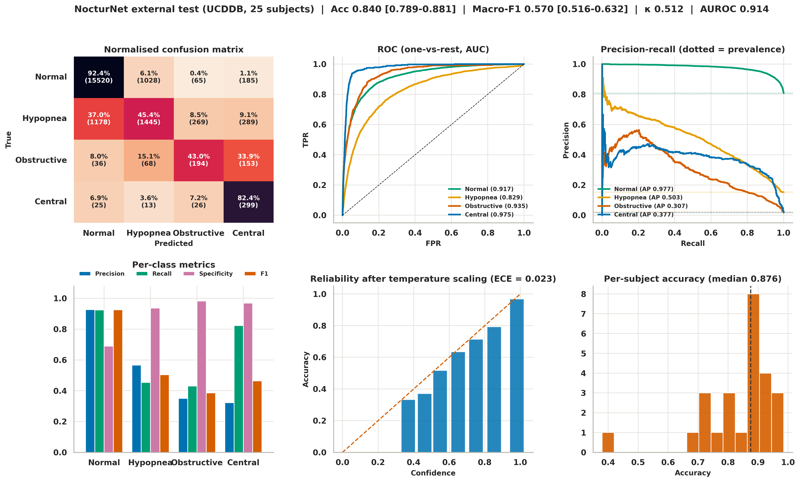
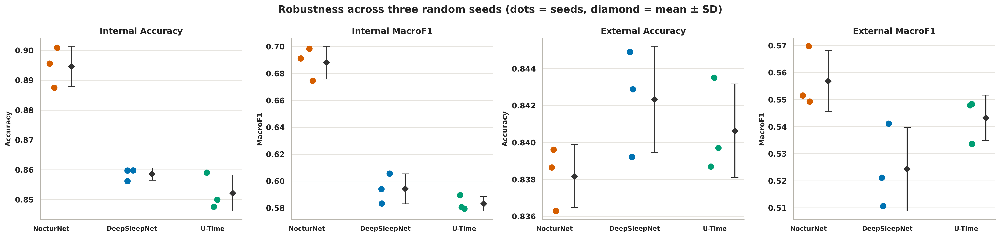
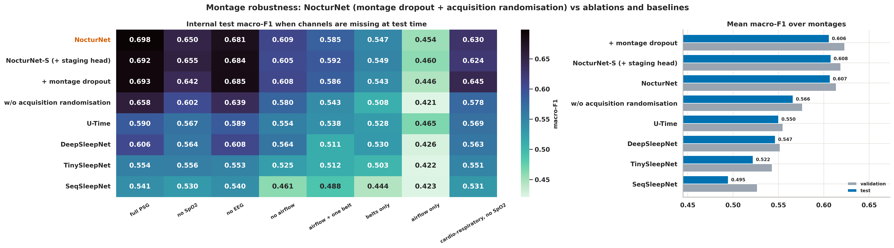
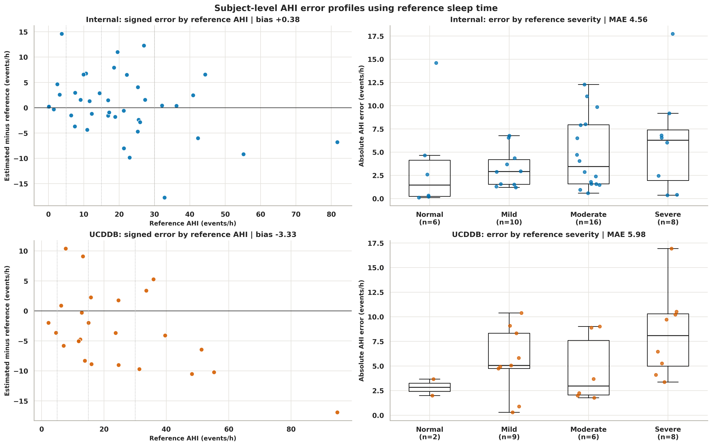

# Results

The tables summarise numerical outputs retained in `Code/NocturNet_FINAL.ipynb`. Each reported value is identified by its evaluation cohort and the corresponding study stage.

## Primary four-class classification

**NocturNet, seed 42**

| Metric | Challenge 2018 test | UCDDB | SLPDB |
|---|---:|---:|---:|
| Accuracy | 0.8956 | 0.8396 | 0.6806 |
| Macro-F1 | 0.6984 | 0.5697 | 0.4717 |
| Cohen's κ | 0.6434 | 0.5121 | 0.3819 |

Challenge-2018 and UCDDB values are taken from Stage 11 (code cell 12); the SLPDB values are taken from Stage 18 (code cell 24).

| Challenge-2018 evaluation | UCDDB evaluation |
|---|---|
|  |  |

## Multi-seed evaluation

The study records seeds **42, 43 and 44**.

| Cohort | Mean macro-F1 | Standard deviation |
|---|---:|---:|
| Challenge 2018 | 0.6880 | 0.0122 |
| UCDDB | 0.5568 | 0.0112 |
| SLPDB | 0.4607 | 0.0114 |

The Challenge-2018 and UCDDB summaries appear in Stage 12b (cell 14). The SLPDB summary appears in Stage 18 (cell 24).

## Comparison with selected models

**Macro-F1, seed 42**

| Model | Challenge 2018 test | UCDDB | SLPDB |
|---|---:|---:|---:|
| NocturNet | 0.6984 | 0.5697 | 0.4717 |
| DeepSleepNet | 0.6056 | 0.5411 | 0.4390 |
| U-Time | 0.5895 | 0.5483 | 0.4327 |

The Challenge-2018 comparator values are included in Stage 12 (cell 13); external-cohort comparisons are present in Stage 19b (cell 27). Additional comparator models, ablations and evaluation measures appear in the notebook and associated figures.

## Signal-montage and class-level analyses

The notebook reports evaluation across multiple input-channel configurations, including full PSG and channel-restricted montages, together with class-wise metrics, confusion matrices and subgroup displays.

| Montage analysis | Per-class summary |
|---|---|
|  |  |

## Sleep-stage and AHI analyses

For the NocturNet-S variant, Stage 16 (cell 22) reports the following sleep-stage metrics:

| Cohort | Accuracy | Cohen's κ | Macro-F1 | Sleep/wake accuracy |
|---|---:|---:|---:|---:|
| Challenge 2018 test | 0.739 | 0.645 | 0.711 | 0.882 |
| UCDDB | 0.685 | 0.579 | 0.646 | 0.878 |

Stage 16 also reports semi-automatic and automatic AHI agreement. The supplied figure collection includes AHI agreement, error profiles, severity-level views and overnight examples.

| Overnight agreement | Event and severity analysis |
|---|---|
|  |  |

## Additional analyses

The notebook and [figure catalogue](FIGURE_ATLAS.md) include calibration, event-level examples, saliency, token attention, external-cohort subject-level analyses, SLPDB secondary analyses and overnight timelines. These materials are organised by their original notebook stages and filenames.
