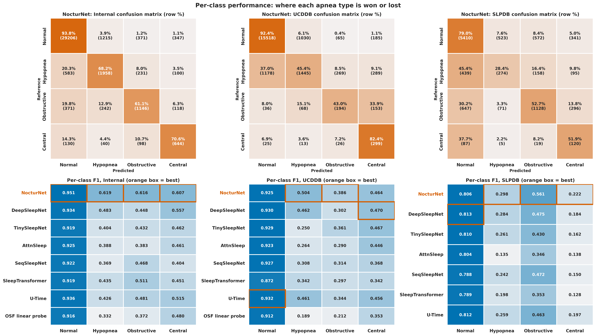

# Results

This section presents respiratory-event classification, multi-seed evaluation, model comparisons, signal-montage analysis, and sleep-stage and apnea–hypopnea index (AHI) results.

## Primary four-class classification

**NocturNet, seed 42**

| Metric | Challenge 2018 test | UCDDB | SLPDB |
|---|---:|---:|---:|
| Accuracy | 0.8956 | 0.8396 | 0.6806 |
| Macro-F1 | 0.6984 | 0.5697 | 0.4717 |
| Cohen's κ | 0.6434 | 0.5121 | 0.3819 |

| Challenge-2018 evaluation | UCDDB evaluation |
|---|---|
|  |  |

## Multi-seed evaluation

Results are summarised across **three random seeds (42, 43 and 44)**.

| Cohort | Mean macro-F1 | Standard deviation |
|---|---:|---:|
| Challenge 2018 | 0.6880 | 0.0122 |
| UCDDB | 0.5568 | 0.0112 |
| SLPDB | 0.4607 | 0.0114 |

## Comparison with selected models

**Macro-F1, seed 42**

| Model | Challenge 2018 test | UCDDB | SLPDB |
|---|---:|---:|---:|
| NocturNet | 0.6984 | 0.5697 | 0.4717 |
| DeepSleepNet | 0.6056 | 0.5411 | 0.4390 |
| U-Time | 0.5895 | 0.5483 | 0.4327 |

Comparative evaluation also includes additional model configurations and ablation analyses.

## Signal-montage and class-level analyses

Signal-montage evaluation examines multiple input-channel configurations, including full PSG and channel-restricted montages, alongside class-wise metrics, confusion matrices and subgroup analyses.

| Montage analysis | Per-class summary |
|---|---|
|  |  |

## Sleep-stage and AHI analyses

Sleep-stage classification results for **NocturNet-S** are presented below:

| Cohort | Accuracy | Cohen's κ | Macro-F1 | Sleep/wake accuracy |
|---|---:|---:|---:|---:|
| Challenge 2018 test | 0.739 | 0.645 | 0.711 | 0.882 |
| UCDDB | 0.685 | 0.579 | 0.646 | 0.878 |

AHI evaluation includes semi-automatic and automatic agreement analyses, error profiles, severity-level assessments and overnight examples.

| Overnight agreement | Event and severity analysis |
|---|---|
|  |  |

## Additional analyses

Further analyses include calibration, event-level examples, saliency, token attention, external-cohort subject-level evaluation, SLPDB secondary analyses and overnight timelines. See the [figure catalogue](FIGURE_ATLAS.md).
