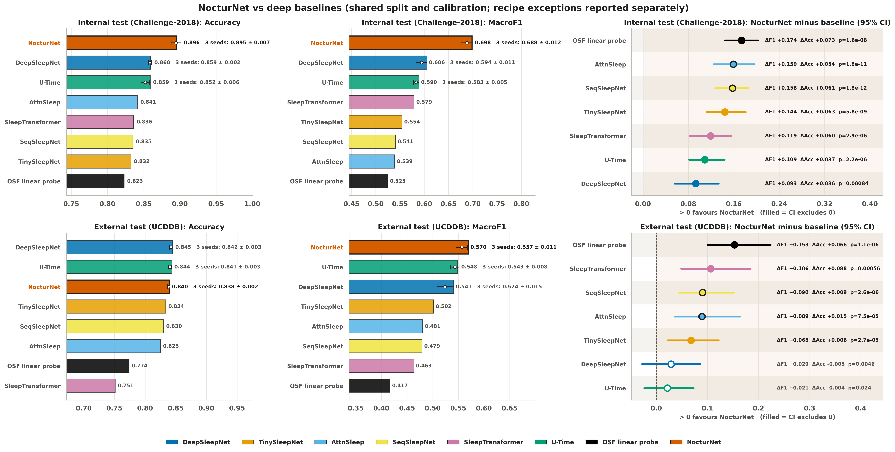
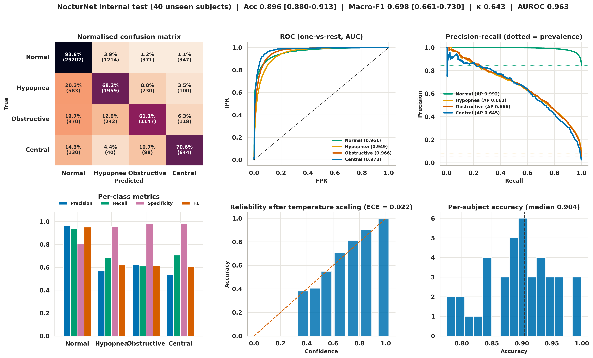
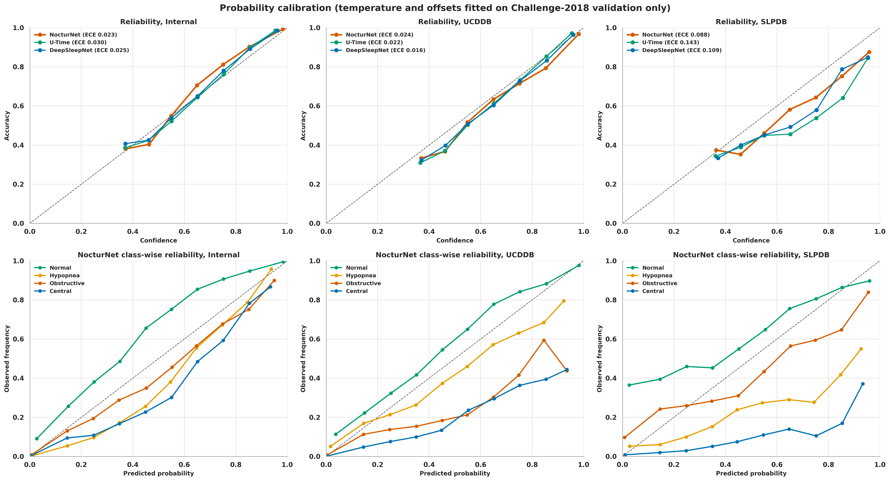

# Results

NocturNet evaluates four-class respiratory-event classification using PhysioNet/CinC Challenge 2018, UCDDB, and SLPDB. Values below follow the supplied notebook's reported metrics and are organized by cohort and evaluation setting. Results from different cohorts or experiment variants should be interpreted within their stated conditions.

## Primary classification results

| Evaluation cohort | Accuracy | Macro-F1 | Cohen's κ | Experiment |
|---|---:|---:|---:|---|
| Challenge 2018 — held-out test | **0.8956** | **0.6984** | **0.6434** | NocturNet, seed 42 |
| UCDDB — external cohort | **0.8396** | **0.5697** | **0.5121** | NocturNet, seed 42 |
| SLPDB — external cohort | **0.6806** | **0.4717** | **0.3819** | NocturNet, seed 42 |

The primary table reports the same model/seed context for each listed evaluation. Differences in cohort composition and label prevalence must be considered when interpreting cross-dataset performance.

## Multi-seed results

The reported mean macro-F1 across seeds **42, 43, and 44** is:

| Cohort | Mean macro-F1 (three seeds) |
|---|---:|
| Challenge 2018 | **0.6880** |
| UCDDB | **0.5568** |
| SLPDB | **0.4607** |

These values are distinct from the seed-42 metrics above. The notebook additionally presents a three-seed SLPDB ensemble and comparisons with U-Time. The reported ensemble advantage over U-Time is small, with a bootstrap confidence interval that includes zero; this specific result does not establish a statistically significant improvement over that comparator.

## Figures

| Model comparison | External evaluation |
|---|---|
|  |  |

| Held-out evaluation | Probability calibration |
|---|---|
|  |  |

| Seed analysis | Signal-montage analysis |
|---|---|
|  |  |

The [figure atlas](FIGURE_ATLAS.md) indexes all 37 figures, including class-wise performance, errors, subgroup analyses, event examples, overnight timelines, and model interpretation.

## AHI-related analyses

The research also includes apnea–hypopnea index (AHI) agreement, AHI error profiles, severity-group summaries, and overnight assessments. In the specified computations, respiratory-positive 30-second epochs contribute to an event-count proxy with a calibration factor and sleep-time denominator. Refer to [Methodology](METHODOLOGY.md), `Code/event_and_AHI_methods.json`, and notebook cells 16–17 and 22 for the precise definitions. These analyses do not imply regulatory clearance or prospective clinical deployment.

## Reading the evidence

The notebook contains class-wise performance, baselines, ablations, multiple random seeds, probability calibration, and cohort-specific evaluation. Results should not be pooled across sample units or different adaptation, ensemble, or calibration conditions. Use the 29-cell notebook and accompanying figures as the detailed source for numerical tables, plots, model variants, and evaluation procedures.
